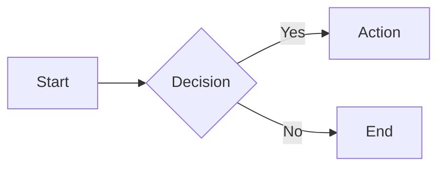

[](https://crates.io/crates/mdtopdf)
[](https://github.com/pepa65/mdtopdf/actions/workflows/rust.yml)
[](https://deps.rs/repo/github/pepa65/mdtopdf)
[](https://docs.rs/crate/mdtopdf/latest)
[](https://github.com/pepa65/mdtopdf/blob/main/LICENSE)
[](https://crates.io/crates/mdtopdf)

# mdtopdf 0.2.0
**Convert Markdown to PDF with Typst**

A fast, lightweight Markdown-to-PDF converter written in Rust. Uses [Typst](https://typst.app/) as the PDF generation engine, so no dependencies on Chromium, Node.js or Pandoc. You're basically leveraging the amazingly rich and capable Typst engine to build your PDF documents by using Markdown enhanced with some Typst-style directives.

* License: MIT
* Repo: https://github.com/pepa65/mdtopdf
* After: https://github.com/caybokotze/markdown-to-pdf

## Features
### Core Markdown
* Text formatting:
  - bold: `**`/`__`
  - italic: `*`/`_`
  - bold+italic: `***`/`___`
  - strikethrough: `~`/`~~`
  - inline code:  `` / ```` /`~~~`
* Headings H1-H6: `#`/`=`, `##`/`==`, `###`/`===`, `####`/`====`, `#####`/`=====`, `######`/`======`
* Lists (ordered, unordered, nested, task lists)
* Blockquotes: `>`
* Links and images
* Tables with alignment
* Code blocks with syntax highlighting:  ```` LANGUAGE

### Advanced Features
* **YAML Frontmatter**: `---` at the very start of the document, `---` at the start of the line after the frontmatter
  [Document metadata (title, author, date, etc.)]
  - title: THE TITLE (Part of the PDF metadata)
  - subtitle: SUBTITLE
  - author: JUST ONE AUTHOR (Part of the PDF metadata)
  - date: YYYY-MM-DD
  - organization: ORGANIZATION
  - font: NAME
  - font-size: SIZE (can be fractional)
  - margins: TOP [RIGHT [BOTTOM [LEFT]]] [`mm`|`cm`|`in`|`pt`] (default: 16 mm)
    * Only TOP: value for all margins
    * TOP and RIGHT: BOTTOM same as TOP, LEFT same as RIGHT
    * TOP, RIGHT, BOTTOM: LEFT same as RIGHT
  - header-left: HEADER_LEFT
  - header-center: HEADER_CENTER
  - header-right: HEADER_RIGHT
  - footer-left: FOOTER_LEFT
  - footer-center: FOOTER_CENTER
  - footer-right: FOOTER_RIGHT
  - toc: `true`|`false`
  - toc-header: TOC HEADER (default: "Table of Contents")
  - cover: `true`|`false` (Cover page has: `title`, `subtitle`, `author`, `date` and `organization`)
  - page-numbers: `true`|`false`
* **Math Equations**: LaTeX syntax with automatic Typst conversion
* **Mermaid Diagrams**: Native rendering via oxdraw
* **Callout Boxes**: GitHub alerts (`[!TIP]`, `[!WARNING]`, etc.)
* **Layout Directives**: Page breaks, columns, grids

### Document Features
**Commandline flags**: [or as above in the YAML Frontmatter]
* Cover pages: `--cover`
* Table of contents: `--toc`
* Headers: `--header-left HEADER_LEFT, `--header-center` HEADER_CENTER, `--header-right` HEADER_RIGHT
* Footers: `--footer-left` FOOTER_LEFT, `--footer-center` FOOTER_CENTER, `--footer-right` FOOTER_RIGHT
* Configurable font and paper size: `--font` NAME, `--font-size` SIZE, `--format` `A4`|`Letter`
* Page numbering: `--no-page-numbers` [default is page numbers]
* Output filename: `-o`/`--output` FILENAME
* Timeout: `--timeout` SECONDS

### Frontmatter
Configure document settings via YAML frontmatter:

```yaml
---
title: My Document
subtitle: A comprehensive guide
author: John Doe
date: 2024-01-15
organization: ACME Corp
toc: true
cover: true
font: Inter
font-size: 11
header-left: My Document
footer-center: Page {page}
---
```

### Layout Directives
Control document layout with special directives:
* `[line-break]`/`[nl]`: Force line break () [Using `\` always breaks to the start of the new line]
* `[page-break]`: Force page break
* `[columns-2]`: Start 2-column layout
* `[columns-3]`: Start 3-column layout
* `[end-columns]`: End column layout
* `[keep-together]`: Keep following content together
* `[table-columns: 1fr, 2fr, 1fr]`: Set table column widths

### Callouts
Supports GitHub-style alerts:

```markdown
> [!TIP]
> This is a helpful tip.

> [!WARNING]
> Be careful with this operation.

> [!NOTE]
> Additional information here.
```

Available types: `TIP`, `WARNING`, `NOTE`, `IMPORTANT`, `CAUTION`, `SUCCESS`, `ERROR`, `INFO`, `DETAILS`

### Math Equations
LaTeX math syntax is supported:

* Inline math: `$E = mc^2$` [the enclosing `$` touch the content, no white-space]
* Display math:
```
$$
\int_{-\infty}^{\infty} e^{-x^2} dx = \sqrt{\pi}
$$
```

### Mermaid Diagrams
Mermaid diagrams are rendered natively:

````markdown

````

## Usage
### Help text
```
mdtopdf 0.2.0 - Convert Markdown to PDF with Typst
Usage: mdtopdf [OPTIONS] <MD_FILE>
Arguments:
  <MD_FILE>  Input markdown file

Options:
  -o, --output <PDF_FILE>              Output PDF file [default: MD_FILE with .pdf extension]
  -f, --font <FONT>                    Font family to use [default: Inter]
  -s, --font-size <FONT_SIZE>          Font size in points (can be fractional) [default: 11]
  -p, --paper <PAPER>                  Paper format (A4/Letter) [default: A4]
  -m, --margins <MARGINS>...           Page margins: `top [right [bottom [left]]] [mm|cm|in|pt]` [default: 16 mm]
      --toc                            Generate Table of Contents
      --toc-header                     Header for Table of Contents
      --cover                          Generate Cover page
      --header-left <HEADER_LEFT>      Header Left text
      --header-center <HEADER_CENTER>  Header Center text
      --header-right <HEADER_RIGHT>    Header Right text
      --footer-left <FOOTER_LEFT>      Footer Left text
      --footer-center <FOOTER_CENTER>  Footer Center text
      --footer-right <FOOTER_RIGHT>    Footer Right text
      --no-page-numbers                Disable page numbers
  -v, --verbose                        Enable verbose output
  -h, --help                           Print help
  -V, --version                        Print version
```

### Examples
```sh
# Convert markdown to PDF (output name inferred from input)
mdtopdf document.md

# Specify output filename
mdtopdf document.md -o output.pdf

# Generate PDF with table of contents and cover page
mdtopdf report.md --toc --cover

# Custom font and paper size
mdtopdf document.md --font "Fira Sans" --font-size 12 --format Letter

# Add some header and footer elements
mdtopdf document.md --header-left "My Document" --footer-center "{page}"

# Verbose output for debugging
mdtopdf document.md -v  # Also retains `document.typ`
```

## Installing
### Download static single-binary
```
wget https://github.com/pepa65/mdtopdf/releases/download/0.2.0/mdtopdf
sudo mv mdtopdf /usr/local/bin
sudo chown root:root /usr/local/bin/mdtopdf
sudo chmod +x /usr/local/bin/mdtopdf
```

### Install with cargo
#### Static musl build from cloned repo
```
# After git-cloning the repo
rustup target add x86_64-unknown-linux-musl
cargo build --release
```

#### Dynamic build with cargo
`cargo install --git https://github.com/pepa65/mdtopdf`

#### Cross-compilation
After each target has been added with: `rustup target add TARGET`

```sh
cargo build --release --target x86_64-pc-windows-msvc
cargo build --release --target x86_64-unknown-linux-gnu
cargo build --release --target x86_64-apple-darwin
cargo build --release --target aarch64-apple-darwin
```

### Install with cargo-binstall
Even without a full Rust toolchain, rust binaries can be installed with the static binary `cargo-binstall`:

```
# Install cargo-binstall for Linux x86_64
# (Other versions are available at https://crates.io/crates/cargo-binstall)
wget github.com/cargo-bins/cargo-binstall/releases/latest/download/cargo-binstall-x86_64-unknown-linux-musl.tgz
tar xf cargo-binstall-x86_64-unknown-linux-musl.tgz
sudo chown root:root cargo-binstall
sudo mv cargo-binstall /usr/local/bin/
```

Only a linux-x86_64 (musl) binary available: `cargo-binstall mdtopdf`

It will be installed in `~/.cargo/bin/` which will need to be added to `PATH`!
