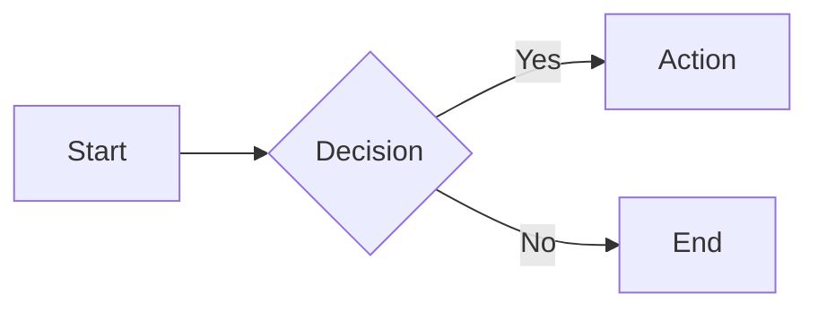

# md2pdf

A fast, lightweight Markdown-to-PDF converter written in Rust. Uses [Typst](https://typst.app/) as the PDF generation engine, eliminating dependencies on Chromium or Node.js.

## Features

### Core Markdown
- Text formatting (bold, italic, strikethrough, inline code)
- Headings (H1-H6)
- Lists (ordered, unordered, nested, task lists)
- Blockquotes
- Links and images
- Tables with alignment
- Code blocks with syntax highlighting

### Advanced Features
- **YAML Frontmatter** - Document metadata (title, author, date, etc.)
- **Math Equations** - LaTeX syntax with automatic Typst conversion
- **Mermaid Diagrams** - Native rendering via oxdraw
- **Callout Boxes** - GitHub alerts (`[!TIP]`, `[!WARNING]`, etc.)
- **Layout Directives** - Page breaks, columns, grids

### Document Features
- Cover pages
- Table of contents
- Headers and footers
- Configurable fonts and paper sizes
- Page numbering

## Building

Requires [Rust](https://rustup.rs/) (2021 edition).

```bash
# Debug build
cargo build

# Release build (optimized for speed)
cargo build --release

# Release build (optimized for size)
cargo build --profile release-small
```

The binary will be located at `target/release/md2pdf` (or `target/debug/md2pdf` for debug builds).

### Cross-compilation

```bash
cargo build --release --target x86_64-pc-windows-msvc
cargo build --release --target x86_64-unknown-linux-gnu
cargo build --release --target x86_64-apple-darwin
cargo build --release --target aarch64-apple-darwin
```

## Usage

### Basic Usage

```bash
# Convert markdown to PDF (output name inferred from input)
md2pdf document.md

# Specify output file
md2pdf document.md -o output.pdf
```

### Options

```bash
md2pdf <INPUT> [OPTIONS]

Arguments:
  <INPUT>              Input markdown file

Options:
  -o, --output <FILE>  Output PDF path (default: input with .pdf extension)
  --font <FAMILY>      Font family (default: "Inter")
  --font-size <PT>     Font size in points (default: 11)
  --format <FORMAT>    Paper format: A4, Letter (default: "A4")
  --timeout <SECS>     Generation timeout in seconds (default: 30)
  --toc                Generate table of contents
  --cover              Generate cover page
  --header-left <TEXT>     Left header text
  --header-center <TEXT>   Center header text
  --header-right <TEXT>    Right header text
  --footer-left <TEXT>     Left footer text
  --footer-center <TEXT>   Center footer text
  --footer-right <TEXT>    Right footer text
  --no-page-numbers    Disable page numbering
  -v, --verbose        Enable verbose logging
  -h, --help           Print help
```

### Examples

```bash
# Generate PDF with table of contents and cover page
md2pdf report.md --toc --cover

# Custom font and paper size
md2pdf document.md --font "Fira Sans" --font-size 12 --format Letter

# Add header and footer
md2pdf document.md --header-left "My Document" --footer-center "{page}"

# Verbose output for debugging
md2pdf document.md -v
```

## Frontmatter

Configure document settings via YAML frontmatter:

```yaml
---
title: My Document
subtitle: A comprehensive guide
author: John Doe
date: 2024-01-15
organization: ACME Corp
toc: true
cover: true
font: Inter
font_size: 11
header_left: My Document
footer_center: Page {page}
---
```

## Layout Directives

Control document layout with special directives:

```markdown
[page-break]           <!-- Force page break -->
[columns-2]            <!-- Start 2-column layout -->
[columns-3]            <!-- Start 3-column layout -->
[end-columns]          <!-- End column layout -->
[keep-together]        <!-- Keep following content together -->
[table-columns: 1fr, 2fr, 1fr]  <!-- Set table column widths -->
```

## Callouts

Supports GitHub-style alerts:

```markdown
> [!TIP]
> This is a helpful tip.

> [!WARNING]
> Be careful with this operation.

> [!NOTE]
> Additional information here.
```

Available types: `TIP`, `WARNING`, `NOTE`, `IMPORTANT`, `CAUTION`, `SUCCESS`, `ERROR`, `INFO`, `DETAILS`

## Math Equations

LaTeX math syntax is supported:

```markdown
Inline math: $E = mc^2$

Display math:
$$
\int_{-\infty}^{\infty} e^{-x^2} dx = \sqrt{\pi}
$$
```

## Mermaid Diagrams

Mermaid diagrams are rendered natively:

````markdown

````

## License

MIT
