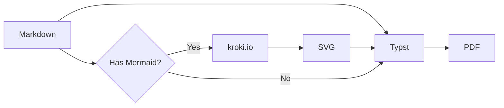
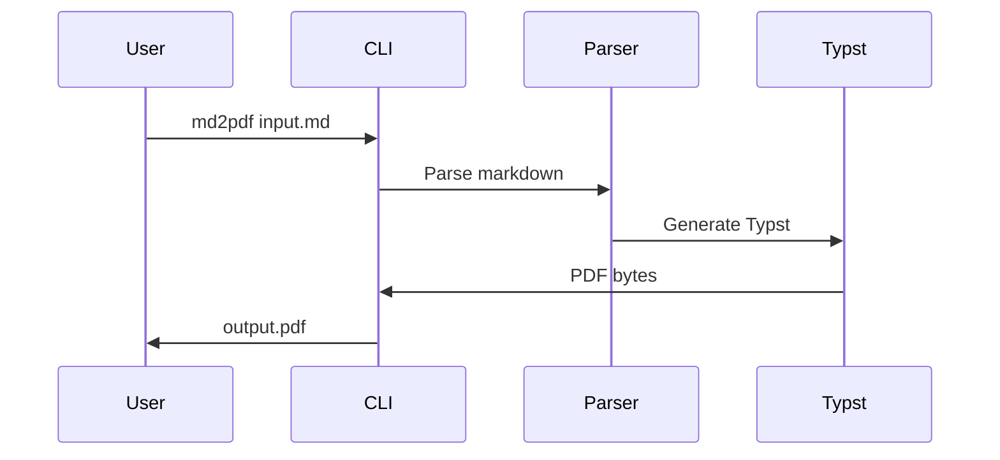
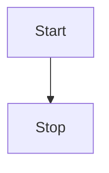

# Introduction

This document demonstrates the features implemented in the **md2pdf** Rust rewrite. The tool converts Markdown to PDF using Typst as the rendering engine, eliminating the need for Chromium/Puppeteer.

## Key Benefits

- **Fast conversion**: Sub-second PDF generation
- **Small binary**: No Chromium dependency (~20MB vs ~500MB)
- **Native rendering**: Uses Typst for high-quality output

---

# Text Formatting

## Basic Formatting

Regular text with *italic*, **bold**, and ***bold italic*** styles.

You can also use `inline code` for technical terms like `fn main()` or `cargo build`.

Here's some ~~strikethrough~~ text for corrections.

## Links

Visit the [Typst documentation](https://typst.app/docs) for more information.

---

# Lists

## Unordered Lists

- First item
- Second item
  - Nested item A
  - Nested item B
    - Deeply nested
- Third item

## Ordered Lists

1. First step
2. Second step
3. Third step
   1. Sub-step A
   2. Sub-step B

## Task Lists

- [x] Project setup with Cargo
- [x] CLI argument parsing with Clap
- [x] Markdown parsing with pulldown-cmark
- [x] Typst conversion
- [x] PDF generation
- [ ] Web API (optional feature)
- [ ] MCP Server (optional feature)

---

# Code Blocks

## Rust Example

```rust
use anyhow::Result;
use clap::Parser;

#[derive(Parser)]
struct Args {
    /// Input markdown file
    input: PathBuf,

    /// Output PDF file
    #[arg(short, long)]
    output: Option<PathBuf>,
}

fn main() -> Result<()> {
    let args = Args::parse();
    println!("Converting {:?} to PDF...", args.input);
    Ok(())
}
```

## TypeScript Example

```typescript
interface DocumentMetadata {
  title?: string;
  subtitle?: string;
  author?: string;
  date?: string;
  toc?: boolean;
  cover?: boolean;
}

async function convertMarkdown(
  content: string,
  metadata: DocumentMetadata
): Promise<Uint8Array> {
  // Convert markdown to PDF
  return new Uint8Array();
}
```

## Python Example

```python
from dataclasses import dataclass
from typing import Optional

@dataclass
class Config:
    input_file: str
    output_file: Optional[str] = None
    font: str = "Inter"
    font_size: int = 11

def convert_to_pdf(config: Config) -> bytes:
    """Convert markdown file to PDF."""
    with open(config.input_file) as f:
        content = f.read()
    # ... conversion logic
    return b""
```

---

# Tables

## Feature Comparison

[table-columns: 1fr, 2fr, 2fr]

| Feature | .NET + Puppeteer | Rust + Typst |
|---------|------------------|--------------|
| Binary Size | ~500MB | ~20MB |
| Startup Time | 2-5 seconds | <100ms |
| Memory Usage | ~200MB | ~20MB |
| Dependencies | Chromium, Node.js | None |
| Math Support | KaTeX | Native |

## Implementation Status

[table-columns: 2fr, 1fr, 3fr]

| Component | Status | Notes |
|-----------|--------|-------|
| CLI | Complete | All options implemented |
| Frontmatter | Complete | YAML parsing |
| Markdown | Complete | Full CommonMark |
| Code Blocks | Complete | With titles |
| Tables | Complete | With alignment |
| Math | Complete | LaTeX to Typst |
| Callouts | Complete | GitHub-style |
| Directives | Complete | Page/column layouts |
| Mermaid | Complete | Via kroki.io |
| Web API | Not Started | Future work |

---

# Math Equations

## Inline Math

The famous equation $E = m c^2$ shows mass-energy equivalence.

Greek letters: $alpha$, $beta$, $gamma$, $delta$, $pi$, $omega$.

## Display Math

The Gaussian integral:

$$integral_(-infinity)^(infinity) e^(-x^2) d x = sqrt(pi)$$

Euler's identity:

$$e^(i pi) + 1 = 0$$

A series:

$$sum_(n=1)^(infinity) 1/n^2 = pi^2/6$$

---

# Mermaid Diagrams

Mermaid diagrams are rendered via kroki.io and embedded as SVG images.

## Flowchart



## Sequence Diagram



## Simple Flow



---

# Callout Boxes

## GitHub-Style Alerts

> [!TIP]
> This is a tip callout. Use it to highlight helpful information.

> [!WARNING]
> This is a warning callout. Use it for potential issues.

> [!NOTE]
> This is a note callout. Use it for additional context.

> [!IMPORTANT]
> This is an important callout. Use it for critical information.

> [!CAUTION]
> This is a caution callout. Use it for dangerous operations.

## Emoji-Style Callouts

> **Note:** You can also use text-prefixed callouts for compatibility.

---

# Blockquotes

> "Simplicity is the ultimate sophistication."
>
> This is a regular blockquote that spans multiple lines. It can contain various formatting like **bold** and *italic* text.

---

# Horizontal Rules

Above the rule.

---

Below the rule.

---

# Layout Directives

[page-break]

# New Page

This content appears on a new page after the page break directive.

[page-break]

## Two-Column Layout

[columns-2]

**Left Column Content**

This text will appear in a two-column layout. Multi-column layouts are useful for comparison content or fitting more information on a page.

**Right Column Content**

The column layout automatically distributes content between the columns. Typst handles the column balancing.

[/columns]

---

# Conclusion

The md2pdf Rust rewrite successfully implements the core features needed for markdown to PDF conversion:

1. **Complete Markdown Support**: All CommonMark features plus extensions
2. **Professional Output**: Cover pages, TOC, headers/footers
3. **Advanced Features**: Math equations, code highlighting, callouts
4. **Layout Control**: Page breaks, column layouts

## Future Work

- Web API implementation (Phase 15)
- MCP Server for Claude integration (Phase 16)
- Google Fonts auto-download
- Image gallery support

---

*Generated with md2pdf (Rust + Typst)*
