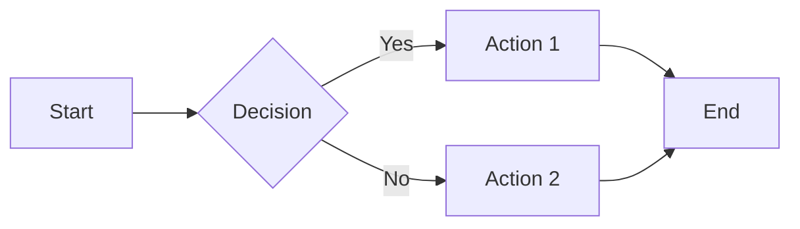

# Feature Test Document

This document tests the new features implemented in phases 4-7.

## Phase 4: Styled Code Blocks

### Simple Code Block

```rust
fn main() {
    println!("Hello, World!");
}
```

### Code Block with Title

```python title="Example Python Script"
def greet(name: str) -> str:
    return f"Hello, {name}!"

print(greet("World"))
```

### Code Block with Title in Comment

```javascript
// title: Event Handler
function handleClick(event) {
    console.log('Button clicked!');
    event.preventDefault();
}
```

## Phase 5: Callout Boxes

### GitHub-style Alerts

> [!TIP]
> This is a tip callout using GitHub-style syntax.

> [!WARNING]
> This is a warning callout. Be careful!

> [!NOTE]
> This is a note for additional information.

### Emoji Callouts

> This is a regular blockquote without callout styling.

## Phase 6: Math Equations

### Inline Math

The famous equation $E = mc^2$ shows mass-energy equivalence.

The quadratic formula is $x = \frac{-b \pm \sqrt{b^2 - 4ac}}{2a}$.

### Display Math

$$
\int_0^\infty e^{-x^2} dx = \frac{\sqrt{\pi}}{2}
$$

$$
\sum_{n=1}^{\infty} \frac{1}{n^2} = \frac{\pi^2}{6}
$$

## Phase 7: Mermaid Diagrams



## Summary

All phases implemented:
- Phase 4: Styled code blocks with title support
- Phase 5: Callout boxes (GitHub alerts, emoji, text prefix)
- Phase 6: LaTeX to Typst math conversion
- Phase 7: Mermaid diagrams via oxdraw
