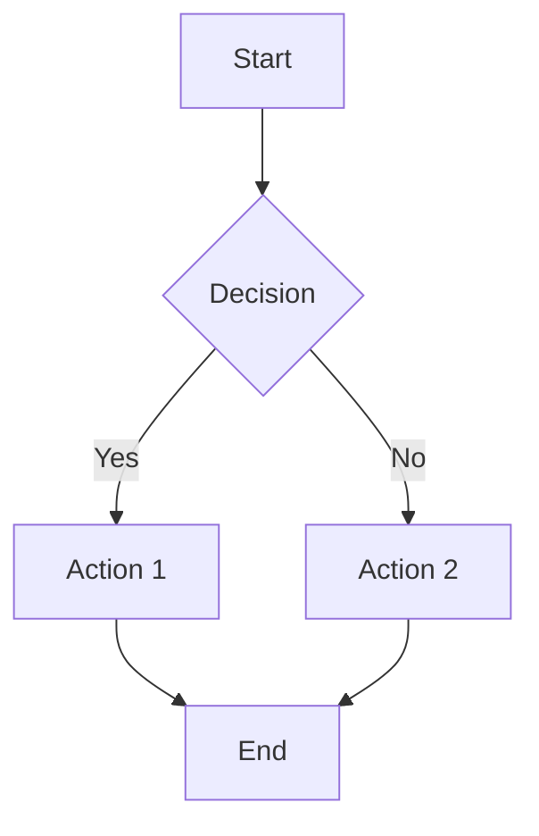
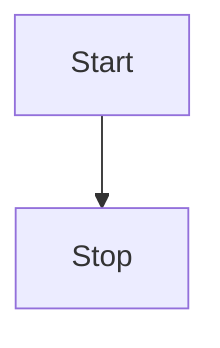
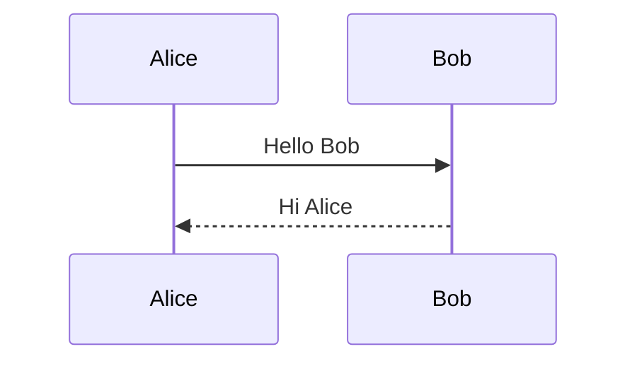

# Mermaid Diagram Tests

Testing various mermaid diagram types.

## Simple Flowchart

## Flowchart with Decisions

## Top-Down Flow

## Sequence Diagram

This document tests mermaid rendering via oxdraw.
